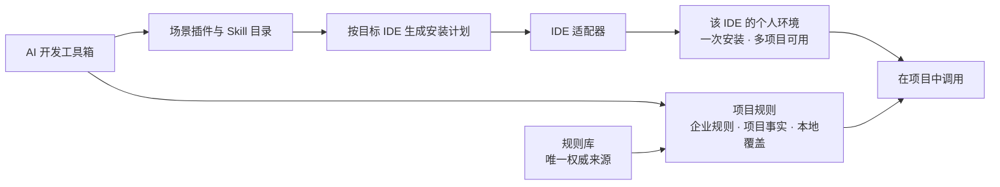

# AI 开发工具箱：产品定位与架构

本文把已确认的产品方向、建议采用的架构和当前实现分开描述；目标能力不代表已经交付。

## 一句话定位

**AI 开发工具箱是独立于任何 AI 编程 IDE 的产品。**用户在电脑上安装一次工具箱；插件和 Skills 按需要选择，分别安装到所选软件的个人环境，在该软件的多个项目中复用。工具箱分别管理项目规则和软件级插件、Skills，并由适配器处理各软件的交付差异。

它不等于 Codex、Cursor、TraeCode 或 Qoder 的某一个插件，也不等于一套通用规则。未来交付给宿主 IDE 的插件包只包含选定能力，不包含工具箱平台本身。

**产品方向是以场景插件作为用户主要入口。**用户通常先选择“我要完成哪类工作”，再由工具箱组合所需 Skills、工具连接和当前项目规则。插件优先是本产品的设计选择；不能仅凭别家提供插件市场就断言插件的实际使用量高于 Skills。

## 产品的四块结构

| 组成 | 回答的问题 | 权威来源与边界 |
| --- | --- | --- |
| 规则库 | 当前企业和项目要求 AI 遵守什么？ | 通用基线、企业要求、项目事实和本地覆盖按适用范围组合。规则正文只维护一份；生成给 IDE 的文件是安装产物。 |
| Skill 库 | 某类任务按什么步骤完成？ | 维护可复用的任务流程与依赖声明。通用 Skill 在运行时读取当前有效规则，不写死某家企业的要求。 |
| 能力插件库 | 用户要完成哪类开发工作？ | 作为主要可发现、可安装入口，维护场景能力、依赖、权限和版本。一个插件可组合多个 Skills 和工具连接，但不因此成为企业规则的第二份来源。 |
| IDE 适配器 | 这些内容怎样在目标 IDE 中安装和生效？ | 分别处理格式、路径、命名、宿主权限、调用方式和验证。适配器可能生成 IDE 插件包，但 IDE 插件包不等于工具箱本身或能力插件库。 |

工具箱应用或 CLI 是以上四块的**管理入口**：负责项目列表、资产选择、安装计划、差异审查、状态记录、更新和卸载。它不是第五类开发资产。

### 两种容易混淆的“插件”

- **工具箱的能力插件**：产品目录中的一项可选能力，例如将来用于代码托管或设计协作的能力。
- **目标 IDE 的插件包**：Codex、Qoder 等宿主用于安装内容的格式。它可以装入某项能力插件及其 Skills、工具或规则入口，但不充当工具箱平台的入口。

过去的 `plugins/agent-rule-kit/` 是一个规则管理 Codex 包，却以“AI开发工具箱”在 Codex 市场展示，造成平台可以装进 IDE 的误解。该包和仓库市场入口已退役；已装在个人 Codex 中的副本仍需用户单独卸载。

## 插件优先的使用方式

工具箱可提供面向项目阶段或技术领域的插件。以下是拟议的产品目录，不代表已经实现：

| 场景插件 | 用户要完成的工作 | 可组合的内容与交接结果 |
| --- | --- | --- |
| 产品经理／产品规划 | 梳理需求、范围、验收标准和优先级 | 需求分析等 Skills；输出可供设计和开发使用的需求说明、任务清单。 |
| UI 设计 | 设计信息结构、页面流程、界面和交互 | 设计 Skills、素材或设计工具连接；输出设计稿、交互说明与交付规格。 |
| 前端开发 | 实现页面、组件、状态和接口对接 | 前端 Skills、测试与浏览器工具；输出代码、测试和验收记录。 |
| 后端开发 | 设计并实现接口、数据和服务 | 后端 Skills、接口与数据库工具；输出契约、实现、测试和迁移说明。 |
| Unity 开发 | 实现场景、交互、资源和构建验证 | Unity Skills、编辑器或构建工具；输出工程变更与实际验证记录。 |

用户在统一的“插件与技能”模块自由选择需要的内容，再选择兼容的目标软件安装。上表是能力示例，不是按项目技术栈强制安装的分组；安装不要求登记项目或选择语言。目录可用任务标签帮助查找，实际任务需要时再衔接需求、设计、实现和验收的产物。

每个能力插件至少应声明：适用任务、输入与输出、包含或依赖的 Skills、需要的工具与授权、所读取的规则类别、支持的 IDE 和运行环境。单个 Skill 仍可独立安装；当插件已经包含它时，工具箱应避免重复安装。插件自带的执行安全约束可以保留，但企业和项目规则仍从规则库组合，不复制进每个插件维护。

参考事实：[Codex 插件可以包含 Skills、MCP 和 Hook](https://developers.openai.com/plugins/concepts/plugins)；[TraeCode 将插件定义为场景能力，部分插件包含 MCP Server 和 Skill](https://docs.trae.cn/ide_marketplace)。这些是宿主支持的能力形态，不是用户采用比例的数据。

## 多项目与安装范围

工具箱维护两个独立流程：项目页管理各项目的规则；“插件与技能”模块管理目标软件中的插件和 Skills。**插件和 Skills 只安装到目标软件的用户环境，不做项目级安装、绑定或启用。**在 Codex 中安装一次后，可在该用户的不同 Codex 项目中调用；TraeWork 等其他软件分别安装和记录。这里的应用级指软件个人环境，不是给电脑上所有账号安装。

规则库可由工具箱统一维护，但企业要求、技术栈和项目事实不能因为插件装在 IDE 的个人环境就变成所有项目共用一套规则。当前桌面版 `1.1.0` 和 CLI 会把规则写入指定项目的 `.agent-rules/` 与 `AGENTS.md`；这属于**项目规则交付方式**，不应成为未来通用 Skill 或能力插件的默认安装方式。

安装时至少区分三件事：

1. **资产来源**：内容来自工具箱官方、企业、个人还是项目仓库。
2. **安装目标**：插件和 Skills 送往哪个软件的个人环境；按目标软件分别记录安装状态和版本。若宿主无法提供用户环境安装，当前交付应标为不支持，不自动降为项目级安装。
3. **运行位置与身份**：本机或云端执行；连接外部服务时使用哪个账号、哪些权限。安装成功不代表云端同步、外部授权和运行时依赖都已经满足。

界面以“插件与技能 → 选择需要的内容 → 选择目标软件 → 预览 → 安装”为主流程，提供按软件查看已安装内容、更新和卸载的操作。插件带来的 Skill 与工具依赖应在安装计划中展开；安装后由目标软件按任务调用，不增加按项目启用步骤。项目页只处理项目规则；企业强制要求与项目覆盖发生冲突时，先显示冲突并要求处理。

## 安装与调用的关系

插件与技能 的安装顺序是：选择需要的内容和目标软件 → 展开依赖、权限和个人环境中的已有内容 → 预览差异 → 安装并验证 → 记录该软件的版本与归属。此流程不读取项目列表或技术栈作为安装前置条件。项目规则是另一项操作：选择项目 → 选择规则包与目标平台 → 预览 → 应用并验证。两类更新和卸载分别预览执行，不覆盖未知文件。

**运行时不要把规则当成需要用户单独“调用”的功能：**

1. 用户提出任务，例如“审查这个 PR”。
2. IDE 调用个人环境中已安装的“代码审查”插件入口，或用户直接调用独立 Skill；插件内的 Skill 规定审查步骤。
3. Skill 在执行任务时读取宿主当前工作项目的规则与事实，确定审查标准；无需在工具箱中预先绑定或启用。无法确定任务项目时应要求明确，不套用别的项目的规则。
4. 如需读取 PR、CI 等外部信息，再调用已授权的插件工具；涉及权限或强制限制的操作还须由执行端校验。

如果能力插件已经打包某个 Skill，安装计划应把它视为同一项依赖，避免再装一个同名独立 Skill。不同 IDE 对重名 Skill 和规则的处理不一致，不能假定它们会自动合并。规则可按宿主要求生成到项目文件或运行时上下文中，但其权威正文仍在规则库，安装产物要能追溯版本和来源。

## 一个具体例子

用户在工具箱中登记 A、B 两个项目。A 是企业 Unity 工程，B 是个人 TypeScript 工程：

- A 安装企业规则和 Unity 规则；B 安装个人选择的 TypeScript 规则。两者互不覆盖。
- 如果 A、B 都用 Codex，“代码审查”Skill 在 Codex 个人环境安装一次即可复用，但每次读取所在项目的有效规则。
- 如安装代码托管能力插件，它提供读取 PR 等工具；账号和授权由目标软件的连接配置管理，任务执行时核对目标仓库权限。
- A 用 Codex、B 用 TraeCode 时，同一通用能力需分别交付到两个 IDE；不会把 Codex 插件目录原样复制给 TraeCode。
- 用户可按需向各软件安装“产品规划”“UI 设计”“前端开发”“后端开发”“Unity 开发”等插件，也可单独选 Skills；使用 A、B 时无需另设项目启用开关，任务读取各自的规则。

## 当前实现与目标的距离

| 部分 | 当前可确认状态 | 下一阶段目标 |
| --- | --- | --- |
| 多项目管理 | 已发布的桌面版 `1.1.0` 和 CLI 都能按路径处理不同项目；桌面版 1.2.0 增加了独立项目列表，仍没有资产组合管理。 | 项目页查看各项目规则与健康状态；插件与技能 模块按目标软件查看已安装内容、版本、依赖和状态。 |
| 规则 | `rulepacks/` 是唯一权威正文；桌面版与 CLI 可把选定规则安装进业务项目的 `.agent-rules/`，保留本地覆盖并预览更新差异。桌面版可为四个目标生成一份共享 `AGENTS.md` 入口，其他客户端实际加载仍待验收。 | 增加企业配置、项目事实与多 IDE 规则交付的显式组合和冲突处理。 |
| Skills | 原有四个规则管理 Codex Skill 已退役；新增 Product Design 的 TraeWork 入口 Skill 适配实验，完整源 Skills 仅导入本机。自有开发任务 Skill 库尚未实现。 | 建立独立的开发任务 Skill 库，声明规则与工具依赖，逐 IDE 验证调用。 |
| 能力插件 | 尚无独立的能力插件目录、目录契约和企业组合机制。 | 以产品规划、UI、前端、后端、Unity 等场景插件为主要用户入口，建立可选择、可版本化的能力目录，并管理依赖、授权、交接和卸载。 |
| IDE 交付 | 已移除旧 Codex 规则管理插件包。桌面版 1.2.0 新增“插件与技能”模块，支持 Codex 原生插件、Codex／TraeWork 独立 Skill 和已知 Product Design 的 TraeWork 入口 Skill 的预览安装、更新、卸载及安装记录检查。Codex 插件通过官方 CLI 确认安装，Codex Skill 通过只读列表检查用户级识别，TraeWork 目前仅检查本地文件并标为实验支持；实际任务调用分别验收。 | 补齐真实场景、工具依赖组合和各客户端调用验收；新 TRAE、其他原生插件宿主及云端交付需分别实现。 |

因此，当前阶段应称为**已发布的独立规则管理桌面版与 CLI，加上正在开发的多项目平台底座**。已发布桌面版虽可生成多目标共享规则入口，当前源码也已移除旧 Codex 包，但还不能称为完整的跨 IDE 规则、Skill、能力插件市场。

本机导入实验不改变三类资产的边界：Product Design 是外部源插件，工具箱保存和管理它，TraeWork 收到的是适配后的 Skill 包。源包标注专有许可，原文保存在用户本机；代码仓库只维护导入器、适配层和验收记录。不能把“可导出”“客户端已安装”“某条工作流实际调用通过”和“插件全部工具能力兼容”视为同一个状态。见[Product Design 迁移实验](product-design-traework-experiment.md)。

## 建议的近期产品顺序

1. 完成并验收项目列表和规则状态，同时建立独立的“插件与技能”模块，按需要自由选择、按目标软件安装，不加入项目级安装和启用。
2. 定义一个边界清楚的场景插件及其输入输出，先在 Codex 上完成端到端使用，并补齐运行依赖；不要一开始打包整个开发生命周期。
3. 在该插件中使用真正的开发任务 Skills 和所需工具，验证规则只维护一份、调用不重名、依赖与权限可见、卸载能清理自身产物。
4. 将同一资产定义经第二个 IDE 适配器交付并实测，再宣布跨 IDE 兼容。

上述顺序是实施建议，不代表这些能力已存在。企业规则的强制级别、项目覆盖边界、云端同步及首个能力插件场景仍需分别制定可测试的契约。

桌面版 1.2.1 将“我的项目”“项目规则”“插件与技能”分为三个独立页面。项目登记只管理本机路径列表，项目规则仍写入对应项目，插件与技能仍安装到所选软件的用户环境。界面不重复文档中的介绍与操作说明。
